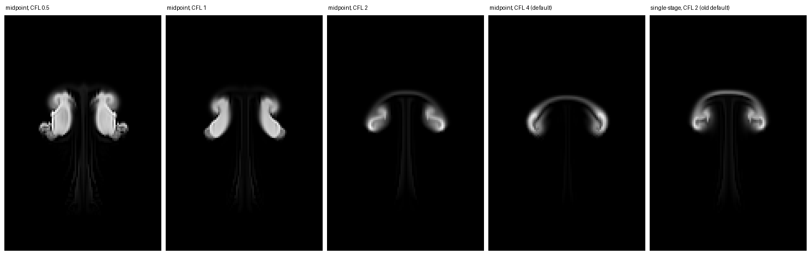
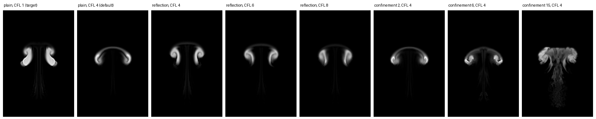
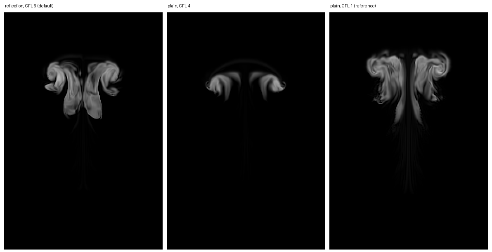

# GPU sparse gas solver: research and first increment

This document records what was researched, what was decided and why, what exists in the
repository now, and what has and has not been verified.

## Goal

A smoke solver whose cost follows the smoke instead of the bounding box, running on the GPU,
usable from the Geometry Nodes gas node. The dense Mantaflow-based node in `blender/` stays the
correctness reference for the physics.

## Findings

**Sparse layouts used for simulation on GPUs**

- NanoVDB stores a VDB tree without pointers so it can be copied to a GPU unchanged. Until
  recently it assumed static topology, which rules it out as a simulation container. Index grids,
  introduced with fVDB, separate topology from data: the tree maps a voxel to an index into flat
  side arrays. A 2026 NVIDIA paper adds GPU topology updates (dilation, merge, prune) and a
  "voxel-sequential" access scheme for stencils, and links to the OpenVDB repository for code.
  [NanoVDB](https://research.nvidia.com/labs/prl/publication/nanovdb),
  [Dynamic GPU Sparse Grids](https://research.nvidia.com/labs/prl/publication/sifakis2026dynamic/)
- GVDB Voxels ran FLIP fluids on a sparse brick hierarchy with a matrix-free conjugate gradient
  pressure solve on the GPU. [Fast Fluid Simulations with Sparse Volumes on the GPU](https://diglib.eg.org/handle/10.1111/cgf13350)
- SPGrid pairs a sparse paged grid with an adaptive multigrid-preconditioned CG solver, on the
  CPU. DCGrid positions itself as combining GPU execution with a multigrid hierarchy.
  [SPGrid](https://pages.cs.wisc.edu/~sifakis/papers/SPGrid.pdf),
  [DCGrid](https://graphics.tudelft.nl/~klaus/papers/DCGrid.pdf)

**How production sparse smoke solvers treat the inactive region**

- Houdini's sparse pyro keeps 16³ tiles active where reference fields (density, flame) are
  non-zero, pads that set, and rebuilds it every step. Inactive space is treated as vacuum that
  smoke can move into, and two separate puffs do not see each other until their active regions
  merge. Its pressure projection uses unsmoothed aggregation multigrid with internal boundaries
  treated as open. [Sparse pyro](https://www.sidefx.com/docs/houdini/pyro/sparsity.html),
  [Sparse Smoke Simulations in Houdini](https://history.siggraph.org/?p=41379)
- Axiom is a commercial GPU sparse solver for Houdini with OpenCL, CUDA, and Metal backends and
  a CPU fallback when a simulation exceeds GPU memory.
  [Axiom](https://www.cgchannel.com/2024/09/matt-puchala-releases-axiom-3-for-houdini/)

**What Blender offers**

- Checked in the pinned source: Blender's GPU module has compute dispatch
  (`GPU_compute_dispatch`), storage buffers with read-back (`GPU_storagebuf_read`), and is used
  for compute by EEVEE, the draw manager, and GPU subdivision. Its shaders are GLSL.
- Vulkan became an officially supported backend in Blender 4.5.
  [Projects update](https://code.blender.org/2025/05/projects-update-q2-2025/)
- The pinned Blender libraries bundle NanoVDB 32.9, including `PNanoVDB.h`, the portable
  C/GLSL/HLSL accessor header, and a `cuda` directory.
- Geometry Nodes evaluate on worker threads. Nothing found shows a geometry node using the GPU
  module, so how a node obtains a GPU context is unresolved (see open questions).

## Decisions

1. **Portable compute shaders, not CUDA.** The reference implementations with GPU topology
   updates are CUDA. Blender cannot make a core node depend on one vendor, and its own GPU module
   is GLSL on Vulkan, Metal, and OpenGL. The kernels are therefore plain GLSL compute shaders over
   storage buffers, which is what Blender's GPU module consumes.
2. **Fixed-size bricks with a flat brick table, not a VDB tree, for now.** A dense table over the
   brick grid maps a brick to a storage slot; channels are flat float arrays indexed by
   `slot * brick_volume + local`. A lookup is one table read, there is no tree traversal in the
   shaders, and the same arrays are uploaded unchanged. With 8³ bricks a brick is exactly an
   OpenVDB leaf node, so import and export can become per-leaf copies. The cost is the dense
   table: 4 bytes per brick of the bounding box, so 16 MB for a 1024³ domain. A NanoVDB index
   grid would remove that and is the likely long-term container; the kernels only depend on
   "coordinates to index", so the swap is contained.
3. **Topology on the CPU.** Deciding which bricks are active is a small per-brick computation. It
   stays on the CPU until profiling says otherwise.
4. **Open air outside the active region.** Like Houdini, inactive space has pressure zero and
   smoke may flow into it. The domain's outer voxel layer remains a closed wall, as in Mantaflow.
   This is a different boundary condition from the dense closed-box solve, so the sparse and
   dense results are not expected to be equal. Velocity alone does not keep a brick active: the
   pressure solve induces a small velocity everywhere, so it would activate the whole domain.
5. **A CPU reference with the same layout comes first.** Without it GPU results cannot be
   checked, and Blender needs a CPU fallback in any case (background renders, no GPU). Every CPU
   kernel is a gather over stored voxels and corresponds to one compute shader.

## What exists

| Piece | Location |
| --- | --- |
| Topology, state, dense conversion, CPU reference kernels and step | `include/manta_improve/sparse_gas.hpp`, `src/sparse_gas.cpp` |
| GLSL compute kernels: advect, buoyancy, walls, divergence, jacobi, gradient | `gpu/shaders/` |
| GLSL kernels for the active-region test, cell classification, and moving channels onto a new topology | `gpu/shaders/activity.comp`, `classify.comp`, `remap.comp` |
| Vulkan compute runner: device-memory buffers, batched recording, GPU timestamps | `gpu/vulkan_compute.*` |
| Driver that keeps the state on the device and runs each step | `gpu/sparse_gas_gpu.*` |
| CPU tests | `tests/sparse_gas_tests.cpp` |
| GPU-versus-CPU test and timing | `tests/sparse_gas_gpu_tests.cpp` |

**Staggered storage and the ghost layer.** A voxel stores the velocity of its three lower faces.
A cell can only be solved for if the cells above it along each axis are stored too, or are walls.
The remaining stored cells, a one-voxel layer on the upper sides of the active set, are classified
as open air and hold the faces between fluid and open air. Cell types are computed once per
topology and uploaded.

**The step.** Rebuild topology from the current values, advect density, temperature, and the
three velocity components, add heat and density buoyancy, zero wall faces, solve pressure, subtract
its gradient. Buoyancy and the wall rule follow Mantaflow's operators.

**Advection.** MacCormack by default: a forward and a backward semi-Lagrangian trace, the error
estimate added back for values inside the fluid, and the result clamped to the eight values the
forward trace interpolated. Where that trace reads a voxel without storage, the first-order value
is kept. This is the scheme the Mantaflow node uses, but not the same code; the two have not been
compared.

**Frames.** `advance()` takes a frame in substeps of at most `cfl` voxels of travel, measured by
the largest velocity component at the start of each substep, and fails past a substep limit. On
the device that speed is gathered per brick by the activity kernel and comes back with the
activity flags, so substepping adds no transfer.

**Steps.** By default a step is an advection-reflection step: advect for half the step, add
buoyancy, project; reflect the velocity about its projection; advect the reflected velocity and
the scalars through the projected field for the other half; add buoyancy and project again. With
`reflection = false` a step is one advection, buoyancy, and one projection.

**Obstacles.** `Topology::obstacle` is one bit per voxel of the domain, set where the voxel is
solid and at rest (`DenseFields::obstacle` on the way in). A stored obstacle voxel is a solid
cell, exactly like the domain wall: no pressure unknown, its faces are held at zero, and smoke
is not advected into it. The mask is dense because bricks come and go, and every newly stored
voxel has to be classified; at 192×192×288 it is 1.3 MB. On the device only the classify kernel
reads it. An obstacle voxel without storage is open air like any other unstored voxel, which
is safe because the active region extends at least a brick past the smoke. Obstacles do not
move, and there is no inflow yet.

**The device driver.** The state stays in device memory between steps; `upload()` and
`download()` are the only full transfers. A step is two submissions. The first runs the activity
kernel and downloads one flag per brick, 4 bytes per active brick. The CPU builds the next brick
table from those flags with the same code as the reference, but does not classify cells. The
second submission uploads the brick table and a slot map if the topology changed, moves the six
state channels onto it with the remap kernel, classifies every stored voxel with the classify
kernel, and runs the whole step. With profiling on, every command is followed by a timestamp so
the GPU time of each kernel can be reported. Every command is followed by a full memory barrier.
Descriptor sets are cached per combination of buffers, and parameters are push constants. Channel
buffers are allocated with 50% headroom and replaced when the active set outgrows them. GPU time
is measured with timestamp queries around each submission.

**Pressure.** The system is the 7-point Poisson matrix over fluid cells with Neumann conditions at
walls and Dirichlet zero at open cells. The CPU reference has Jacobi-preconditioned CG, plain
Jacobi sweeps, and multigrid. The GPU path has Jacobi sweeps and multigrid: neither needs a
reduction, so the GPU result can be compared with the reference operation for operation.

**Multigrid.** Coarse levels aggregate 2×2×2 cells with piecewise-constant transfer. The Galerkin
coarse operator of a 7-point stencil is then again a 7-point stencil, a diagonal and one weight
per lower face, so every level shares one smoother and one residual, and nothing special is
needed at walls or at the edge of the active region. Levels that still have several cells per
brick are stored per brick slot like the voxels; from one cell per brick on, levels are small
dense grids over the brick grid, down to at most 2 cells per side. Smoothing is red-black
Gauss-Seidel, two sweeps before and after each coarse correction and eight on the last level.
Plain aggregation underestimates the coarse correction, so it is scaled by 1.4, and the finest
coarse level is visited twice per cycle (a W-cycle at the top, V-cycles below;
`multigrid_w_depth = 1`). These values were chosen by measurement: with the two finest coarse
levels visited twice the residual falls by about 0.31 per cycle on sparse and closed domains from
32 to 128 voxels wide, with one level 0.34, and with plain V-cycles 0.49 to 0.55; larger scaling
factors diverge. One level is the default because it needs about 40% fewer dispatches (see
"Cutting dispatches" below). On the device the voxel-level residual is computed inside the
restriction kernel, which saves a pass over the voxels; the coarse levels keep a residual pass
of their own, because merging it there measured slower. On the device, the coarse operators are rebuilt by kernels whenever the topology
changes, and the voxel level reads a packed word per voxel (cell type and which neighbors are
fluid or not solid) instead of looking up neighbor types.

## Verified

On Linux x86-64, GCC 13, Release.

CPU reference, 7 tests in `sparse_gas_tests`:

- Brick addressing, cell classification, dilation, overhanging bricks.
- Dense round trip is exact.
- CG projection leaves less than 1e-3 divergence, both with all bricks active and with only the
  bricks around a blob active; no flow through closed walls.
- With every brick active, brick sizes 4, 5, 8, and 16 give bit-identical results after 8 steps.
- A buoyant blob rises; without forces nothing moves; an empty state stores nothing.
- Sparse against all-bricks-active on 48×48×96 over 30 steps: peak 176 of 432 bricks (41%),
  plume rise 17.6 against 17.2 voxels, total density within 2%, density relative L2 difference
  0.18.
- 3000 Jacobi sweeps agree with CG to 3e-7 on a 16³ box.
- Multigrid reduces the residual by at least a factor of 0.33 per cycle and by 5e-4 in six
  cycles, on a sparse and on a closed 48×48×64 domain; six steps of a plume solved with ten cycles
  agree with CG to 1.2e-6 in velocity.

- MacCormack keeps a plume's peak density at 0.97 after 25 steps where first-order advection
  leaves 0.72, in fewer active bricks, and stays inside the initial value range.
- `advance()` subdivides frames at CFL 1 and fails when the substep limit is exhausted.

GPU MacCormack and substepping on llvmpipe: every channel equals the CPU reference bit for bit,
with the same substep counts, including a run forced to several substeps per frame.

GPU multigrid on llvmpipe: every channel equals the CPU reference bit for bit (32×32×48 over 8
steps and 48×48×72 over 10). After six cycles the remaining divergence relative to peak velocity
is about 5e-6, against 2e-3 after 60 Jacobi sweeps on the same flow.

GPU kernels, `sparse_gas_gpu_tests`: on llvmpipe, a software Vulkan implementation, every
channel equals the CPU reference bit for bit after each of 8 steps of a rising plume (32×32×48,
60 Jacobi sweeps per step, topology growing from 48 to 64 bricks). This verifies the shaders, the
buffer layout, and the driver.

**First run on a real GPU.** `sparse_gas_gpu_tests 64 20` on an NVIDIA GeForce RTX 3070
(Windows, the CI-built binary), 64×64×96 domain, 60 Jacobi sweeps per step:

- Every channel matched the CPU reference within the test tolerance on all 20 steps; the largest
  difference was 7.3e-6 (scaled by peak velocity), against 72 voxels per second peak velocity. The
  results are not bit-identical as on llvmpipe; the difference stays at round-off level and does
  not grow over the run.
- The active set grew from 64 to 244 of the domain's 768 bricks (about 30%) as the plume rose.
- 19.1 ms per step on the device path against 482 ms per step for the CPU reference.

That timing ratio is **not** a measure of the solver's speed. The CPU reference is deliberately
simple and single-threaded, and is not the Mantaflow engine. That run used the first driver, which
uploaded and downloaded the whole state every step and submitted and awaited about 70 dispatches
separately. The resident driver above replaces it; its timings on a real GPU are still to be
measured with `sparse_gas_gpu_tests <resolution> <steps> --bench`.

**Resident driver on the RTX 3070** (same machine, CI-built binary, 60 Jacobi sweeps per step):

- Comparison mode, 64×64×96, 20 steps: passes with the same round-off-level differences as
  before (largest 7.3e-6). 7.3 ms per step including a full download every step for the
  comparison, against 19.1 ms for the first driver.
- `--bench`, 40 steps each, median per step:

| Domain | Peak active bricks | Wall | GPU | Topology (CPU) |
| --- | --- | --- | --- | --- |
| 64×64×96 | 452 of 768 (59%) | 8.9 ms | 3.9 ms | 2.5 ms |
| 128×128×192 | 1896 of 6144 (31%) | 18.3 ms | 8.0 ms | 8.1 ms |
| 192×192×288 | 4517 of 20736 (22%) | 45.3 ms | 23.8 ms | 17.6 ms |

  The last 192 step, with 2.3 million stored voxels, took 114 ms wall and 62 ms GPU.

What this shows:

- **The CPU topology rebuild is now as large as the GPU work.** It classifies every stored voxel
  on the CPU, and the per-voxel cell types are then uploaded. The topology changed in 24 to 38 of
  40 steps, so this cost is paid almost every step.
- **The GPU work is several times above what memory bandwidth allows.** A rough estimate for one
  Jacobi sweep over 2.3 million voxels is about 0.2 ms at the 3070's bandwidth, about 12 ms for
  60 sweeps, against 62 ms measured for the whole step. Neighbor lookups through the brick table
  and a full barrier after every dispatch are the likely causes; per-kernel timing is needed to
  confirm.
- **The active region grows quickly.** First-order advection diffuses smoke into neighboring
  bricks, and the activity threshold is low. Over 40 steps the plume at 192 reached 22% of the
  box.
- These figures are not comparable with the Mantaflow node's timings: different machine,
  different numerics (60 unconverged Jacobi sweeps against a converged multigrid solve,
  first-order against MacCormack advection), and a different scene.

**After moving cell classification to the GPU and removing duplicate lookups** (RTX 3070, same
runs):

- Comparison mode still passes with the same differences (largest 7.3e-6), and the GPU's cell
  types equal the CPU reference's on every step. 3.2 ms per step including the per-step download,
  against 7.3 ms before.
- `--bench`, median per step:

| Domain | Wall | GPU | Topology (CPU) | Before: wall / GPU / topology |
| --- | --- | --- | --- | --- |
| 64×64×96 | 3.2 ms | 1.8 ms | 0.02 ms | 8.9 / 3.9 / 2.5 ms |
| 128×128×192 | 7.3 ms | 4.9 ms | 0.05 ms | 18.3 / 8.0 / 8.1 ms |
| 192×192×288 | 15.4 ms | 13.1 ms | 0.12 ms | 45.3 / 23.8 / 17.6 ms |

  The last 192 step, with 2.3 million stored voxels, took 29.5 ms wall and 27.1 ms GPU, against
  114 ms and 62 ms before.
- `--profile` at 192×192×288, average GPU time per step over 40 steps: Jacobi sweeps 9.2 ms
  (69%), advection 3.1 ms (23%), buoyancy 0.33 ms, remap 0.16 ms, gradient 0.13 ms, walls
  0.11 ms, classify 0.09 ms, divergence 0.07 ms, activity 0.04 ms, transfers under 0.04 ms. At
  128×128×192 the split is 74% Jacobi and 18% advection.

What this shows:

- **CPU overhead is no longer the problem.** Wall time is now within a few milliseconds of GPU
  time; the remaining gap is largest in steps where buffers grow and are reallocated.
- **The pressure solve dominates, and it is the weakest part numerically too.** 60 Jacobi sweeps
  are about 70% of GPU time and do not converge the pressure at these resolutions. A rough
  estimate puts the sweeps at about 30% of the 3070's memory bandwidth, so kernel tuning could
  gain perhaps two to three times. A solver that converges in far fewer passes (multigrid) is the
  larger gain and also fixes the accuracy problem.

**Multigrid on the RTX 3070, first version** (one dispatch per sweep on every level):

- Comparison mode, 64×64×96, 20 steps: passes; largest difference 9.1e-6.
- 192×192×288, 40 steps, six cycles against 60 Jacobi sweeps:

| | Multigrid | Jacobi |
| --- | --- | --- |
| Divergence left, relative to peak velocity | 4.5e-5 | 4.2e-2 |
| Peak active bricks | 1111 | 4517 |
| Median step, wall / GPU | 19.8 / 15.0 ms | 18.3 / 14.2 ms |
| Last step, wall | 32.7 ms at 1099 bricks | 38.2 ms at 4517 bricks |

  With the pressure converged the plume stays compact: a quarter of the bricks that the
  unconverged Jacobi run activates. Per brick, though, this version was several times slower.
- `--profile` at 192: smoothing on coarse levels 11.1 ms (56%), on the voxel level 3.3 ms (17%),
  advection 1.3 ms. The coarse levels hold about a seventh of the cells, so nearly all of their
  time is overhead: about 1,800 small dispatches per step at roughly 6 µs each.

In response, all dense levels now live back to back in shared buffers and one dispatch can run
a V-cycle over several of them: a single work group of 128 invocations shares each pass over a
level and meets at a barrier between passes.

Handing it **all** dense levels was a mistake that llvmpipe hid. On the RTX 3070 that dispatch
took 28 ms per step at 192 (24 calls of about 1.2 ms), against the 11 ms it replaced, and the
median step rose from 19.8 to 29.2 ms: one work group is slow on the first dense level's 20,736
cells. Results were still correct (comparison passed, same differences). The driver now hands
over only the trailing levels of at most 512 cells and gives larger levels their own dispatches
again; `--tiny-limit` changes the limit and `--w-depth` the W-cycle depth for experiments.

**Variants measured on the RTX 3070**, 192×192×288, 40 steps, six cycles, median per step:

| Variant | Wall | GPU | Divergence left |
| --- | --- | --- | --- |
| Every level its own dispatches (limit 0) | 18.7 ms | 13.8 ms | 4.5e-5 |
| Single dispatch for levels up to 64 cells | 17.4 ms | 13.4 ms | 4.5e-5 |
| Up to 512 cells (default) | 16.8 ms | 13.5 ms | 4.5e-5 |
| Up to 4096 cells | 17.2 ms | 13.8 ms | 4.5e-5 |
| Up to 512 cells, W-cycle on one level only (`--w-depth 1`) | 14.5 ms | 11.1 ms | 7.3e-5 |
| 60 Jacobi sweeps, for reference | 19.3 ms | 14.4 ms | 4.2e-2 |

The comparison run passed again (largest difference 9.1e-6). What the numbers say:

- **The size limit barely matters**; the differences between the first four rows are within the
  run-to-run noise. Individual steps at the same brick count vary by a factor of two (for
  example 5 and 11 ms GPU), so these medians are rough.
- **The solve is bound by the number of dispatches, not by the work.** A 128×128×192 run with
  679 bricks takes about as long (13.1 ms GPU) as the 192×192×288 run with 1111 bricks
  (12.9 ms). In the 192 profile the voxel-level smoothing, where most of the cells are, is
  2.4 ms; smoothing on the coarse levels, with a seventh of the cells, is 4.2 ms.
- Visiting fewer levels twice (`--w-depth 1`) removes about 40% of the dispatches and is the
  only variant that is clearly faster, for a somewhat larger remaining divergence.
- Multigrid now takes about the same time per step as 60 Jacobi sweeps on this scene, leaves
  about 1000 times less divergence, and keeps the plume in a quarter of the bricks.

Because the cost is per dispatch, it should weigh less on larger problems; that is untested.

**MacCormack advection and substepping on the RTX 3070.** Two comparison runs of
`sparse_gas_gpu_tests 64 20` (64×64×96, 20 frames of 1/30 s) passed: the default settings (1 to 2
substeps per frame), and `--cfl 0.5` (up to 8 substeps per frame). The device took the same
number of substeps as the CPU reference in every frame, and the largest difference in any
channel was 1.6e-5. The CPU reference took 1094 ms per frame and the device 11.3 ms.

Whole frames at 192×192×288, 40 frames, median per frame:

| Variant | Wall | GPU | Substeps in 40 frames | Peak bricks | Divergence left |
|---|---|---|---|---|---|
| MacCormack (default) | 95.3 ms | 71.6 ms | 190 | 3246 | 1.1e-4 |
| First-order advection (`--first-order`) | 74.2 ms | 58.4 ms | 169 | 3058 | 5.7e-5 |
| MacCormack, `--w-depth 1` | 82.9 ms | 61.9 ms | 190 | 3246 | 2.1e-4 |

- **A frame now costs 4 to 6 substeps** once the plume is moving (peak speed near 95 voxels per
  second at resolution 64, three times that in voxels at 192), so these figures are not
  comparable with the per-step figures above. Averaged over the run, a substep of the default
  takes 18.3 ms wall (14.1 ms GPU).
- **MacCormack costs about 17% more per substep than first-order advection** (18.3 against
  15.7 ms wall) and takes 12% more substeps, because the sharper plume moves faster.
  `--w-depth 1` brings the substep back to 15.8 ms for twice the remaining divergence.
- **In the profile, multigrid is 72% of the GPU time and advection 23%** (forward pass 10%,
  correction pass 13%). Smoothing on the coarse brick levels (26%) costs as much as smoothing
  on the voxels (25%), which again points at dispatch count, not work.
- The solver no longer fits a 30 fps frame on this scene: substepping, not any single kernel,
  is what moved it from 15 ms to 95 ms per frame.

With the resident driver, on llvmpipe, every channel still equals the CPU reference bit for bit:
32×32×48 over 12 steps, and 48×48×72 over 14 steps, where the active set grows from 64 to 160
bricks and the channel buffers are replaced once.

**Cutting dispatches.** A coarse dispatch costs about 6 µs on the RTX 3070 whatever its size
(672 coarse smoothing dispatches per substep took 4.0 ms in the profile above), so the coarse
levels are paid for by count. Measured on the CPU reference, on a developed 96×96×144 plume
(208 bricks), six cycles each:

| Variant | Residual after 6 cycles | Factor per cycle | Coarse dispatches per cycle |
|---|---|---|---|
| W on two levels, 2+2 coarse sweeps (old default) | 6.3e-4 | 0.31 | 114 |
| W on one level (new default) | 9.4e-4 | 0.34 | 68 |
| Plain V-cycle | 7.1e-3 | 0.49 | 34 |
| W on two levels, 1+1 coarse sweeps | 1.1e-3 | 0.34 | 74 |
| W on one level, 1+2 coarse sweeps | 1.3e-3 | 0.36 | 56 |
| W on one level, 1+1 coarse sweeps | 2.5e-3 | 0.40 | 44 |
| W on two levels, 0+1 coarse sweeps | 4.8e-3 | 0.43 | 54 |

(Dispatch counts are from before the residual was merged into the restriction.)

- **The convergence rate is set by the voxel-level aggregation**, not by how well the coarse
  levels are solved: every variant sits between 0.31 and 0.43 except the plain V-cycle.
- **Fewer coarse sweeps buy little.** Halving them saves a third of the coarse dispatches but
  costs about as much convergence, so the sweeps stay at 2+2. They are now separate settings
  (`multigrid_coarse_pre_sweeps`, `multigrid_coarse_post_sweeps`; `--coarse-sweeps A B` in the
  test program).
- **The W-cycle depth is the lever.** One level instead of two was already measured on the
  RTX 3070 (15.8 against 18.3 ms per substep, twice the remaining divergence, still 2e-4 of the
  peak velocity) and is now the default.
- **Merging the residual into the restriction** removes one of eleven dispatches per level
  visit without changing any result: on llvmpipe the device still equals the CPU reference bit
  for bit. Together with the new default, a substep at 192×192×288 goes from about 1014
  dispatches to about 550.

**Measured on the RTX 3070: the merge did not pay off on the coarse levels.** The comparison run
passed (largest difference 1.1e-5). 192×192×288, 40 frames, 190 substeps each, averaged per
substep:

| Variant | Wall | GPU | Divergence left |
|---|---|---|---|
| Default (W on one level, merged restriction) | 16.8 ms | 14.0 ms | 2.1e-4 |
| `--w-depth 2` | 19.3 ms | 16.2 ms | 1.1e-4 |
| `--coarse-sweeps 1 2` | 15.1 ms | 12.6 ms | 2.8e-4 |
| Before the merge, W on one level (earlier session) | 15.8 ms | 12.2 ms | 2.1e-4 |
| Before the merge, W on two levels (earlier session) | 18.3 ms | 14.1 ms | 1.1e-4 |

- **Nearly half the dispatches gone, and no gain.** Both cycle shapes came out about 6% slower
  than before the merge. The sessions are a day apart and timings vary that much on their own,
  so this shows no gain, not a certain loss.
- **The profile says where.** Scaled by the voxel-level smoothing, which did not change, the
  merged coarse restriction costs about as much with half the visits as the separate residual
  and restriction did before: twice as much per visit. A coarse cell now does the work of its
  eight children in one thread, and on these small levels a dispatch takes as long as its
  longest thread, not as long as its total work. So the 6 µs per coarse dispatch is not a
  fixed cost that fewer dispatches avoid.
- On the voxel level the merged restriction costs about 2.3 ms per frame on the same scale,
  against about 2.8 ms for the two passes it replaced; that part stays.
- **The coarse levels are back to a separate residual pass** (about 600 dispatches per substep).
  This revert is verified on llvmpipe only and has not been timed on the RTX 3070.
- One sweep before and two after on the coarse levels is 10% faster in the same session for a
  third more remaining divergence, in line with the CPU measurement: about even per digit of
  accuracy. The default stays at 2+2.

**Fewer substeps (larger CFL number): not possible with a single-stage trace.** Blender's Mantaflow domain defaults to a
CFL number of 4; this solver uses 2. Measured on the CPU reference, a 48×48×72 plume, multigrid,
MacCormack, 7 frames of 1/8 s (long frames, so the limit sets the step and not the frame
length), initial mass 895:

| CFL | Substeps | Mass kept | Peak density | Density difference from CFL 0.5 (relative L2) |
|---|---|---|---|---|
| 0.5 | 100 | 92% | 0.87 | 0 |
| 1 | 48 | 88% | 0.87 | 0.46 |
| 2 | 25 | 92% | 0.81 | 0.80 |
| 3 | 17 | 63% | 0.78 | 0.80 |
| 4 | 12 | 53% | 0.73 | 0.85 |
| 6 | 11 | 44% | 0.76 | 0.99 |
| 8 | 7 | 34% | 0.93 | 1.09 |

- **Above 2 voxels per step the plume loses smoke quickly**: about a third at 3 and half at 4.
  Up to 2 the mass stays within a few percent of the small-step run.
- **It is not the sparse layout.** A dilation of two bricks gives the same loss (51% kept at
  CFL 4), so smoke is not outrunning the active region. First-order advection loses more at
  every CFL number (60% kept at 2, 30% at 4). The loss comes from the single-stage backward
  trace through a strongly accelerating flow.
- The density fields differ a lot point by point even between CFL 0.5 and 1. The plume is thin
  and rolls up, so this measure mostly reports that the fields are shifted; mass, height
  (within 4% up to CFL 4), and peak density are the usable comparisons.
- With normal frames of 1/30 s at this resolution the plume moves about 2 voxels per frame, and
  every CFL number from 3 up takes one step per frame; the question only arises at higher
  resolution or speed.

**The midpoint trace makes CFL 4 usable.** The departure point is now found with the velocity
half way along a first, single-stage trace (`midpoint_trace`, three more velocity samples per
trace); MacCormack uses it for both its backward and its forward trace. Same scene and
measurement as the table above:

| CFL | Substeps | Mass kept, single-stage | Mass kept, midpoint | Height, midpoint |
|---|---|---|---|---|
| 0.5 | 100 | 92% | 95% | 30.8 |
| 2 | 25 | 92% | 98% | 31.1 |
| 3 | 16 to 17 | 63% | 91% | 30.7 |
| 4 | 12 | 53% | 93% | 30.7 |
| 6 | 10 to 11 | 44% | 85% | 29.0 |

- At CFL 4 the plume keeps 93% of its mass, against 53%, and its height stays within 1% of the
  small-step run. At 6 it starts to fall behind.
- **The defaults are now the midpoint trace and a CFL number of 4**, Blender's Mantaflow
  default. A frame then needs about half the substeps it did at 2.
- On llvmpipe the device equals the CPU reference bit for bit with the midpoint trace.
- A CPU test requires the default to keep at least 65% of a small fast plume's mass and the
  single-stage trace to keep clearly less.

Whether Mantaflow loses mass at its default of 4 has not been checked.

**Midpoint trace and CFL 4 on the RTX 3070.** The comparison run at 64×64×96 passed (largest
difference 5.0e-6; one substep per frame where CFL 2 took two). 192×192×288, 40 frames, one
session:

| Variant | Median frame, wall | Median frame, GPU | Substeps | Wall per substep | Peak bricks | Divergence left |
|---|---|---|---|---|---|---|
| Midpoint, CFL 4 (default) | 50.7 ms | 40.3 ms | 105 | 18.7 ms | 2493 | 2.0e-4 |
| Single-stage, CFL 2 (old default) | 89.3 ms | 67.5 ms | 190 | 17.0 ms | 3246 | 2.1e-4 |
| Midpoint, CFL 2 | 116.9 ms | 89.3 ms | 191 | 22.1 ms | 3368 | 1.7e-4 |

- **A frame takes 43% less time** (39% less summed over the run): 45% fewer substeps, each
  about 10% slower.
- **The trace itself costs about 30% per substep** at equal CFL (22.1 against 17.0 ms).
  Advection is now 46% of the GPU time (forward pass 15%, MacCormack correction 32%) and
  multigrid about 49%.
- **The plume occupies fewer bricks at CFL 4** (2493 against 3246 at the last frame). The two
  runs are different discretisations of the same scene; "The step size changes the look of
  the plume" below compares the shapes on the CPU reference.
- The coarse-level revert cannot be judged from this run: the old settings take 17.0 ms per
  substep here, against 16.8 ms with the merged kernel and 15.8 ms before it in earlier
  sessions, which is within the variation between sessions.

**The step size changes the look of the plume.** The same plume on the CPU reference at
96×96×144 after 1.2 s (18 frames of 1/15 s, so that the CFL number and not the frame length
sets the step), centre slice of the density:

| Setting | Substeps | Mass kept | Height | Top | Width (rms radius) | Bricks |
|---|---|---|---|---|---|---|
| Midpoint, CFL 0.5 | 326 | 108% | 83.2 | 98 | 16.1 | 837 |
| Midpoint, CFL 1 | 155 | 96% | 81.1 | 95 | 16.7 | 747 |
| Midpoint, CFL 2 | 73 | 94% | 79.4 | 96 | 19.5 | 730 |
| Midpoint, CFL 4 (default) | 39 | 97% | 80.5 | 94 | 20.1 | 651 |
| Single-stage, CFL 2 (old default) | 72 | 93% | 81.2 | 97 | 17.9 | 724 |

- **CFL 4 and the old default agree in the gross measures** (height within 1%, top within 3
  voxels), and both give a smooth cap. At CFL 4 the cap is a little wider and flatter and rolls
  up less at the rim, which is also why it occupies fewer bricks.
- **Small steps give a different plume**: at CFL 1 and 0.5 the vortex ring rolls up into a
  detailed mushroom, and the two look alike. The loss of roll-up happens between CFL 1 and 2,
  with either trace, so it comes from the time step of the whole scheme (advection, buoyancy,
  and projection are split), not from the trace.
- At CFL 0.5 the mass grows by 8%: MacCormack's correction is not conservative and this run
  applies it 326 times.
- The CFL number is therefore a speed-against-detail setting, as in Blender's Mantaflow domain.
  The default stays at 4; CFL 1 costs about four times as many substeps.

**Keeping the roll-up at large steps.** Two candidates, on the same scene and measurement as
above (CPU reference, 96×96×144, 1.2 s). "Cost" counts a reflection step as two plain substeps,
since it advects and projects twice; that is an estimate, not a GPU timing.

| Variant | Steps | Cost | Mass kept | Height | Width (rms radius) | Kinetic energy |
|---|---|---|---|---|---|---|
| Plain, CFL 1 (target look) | 155 | 155 | 96% | 81.1 | 16.7 | 2.7e8 |
| Plain, CFL 2 | 73 | 73 | 94% | 79.4 | 19.5 | 2.2e8 |
| Plain, CFL 4 (default) | 39 | 39 | 97% | 80.5 | 20.1 | 2.1e8 |
| Reflection, CFL 4 | 46 | 92 | 98% | 84.7 | 16.1 | 3.5e8 |
| Reflection, CFL 6 | 32 | 64 | 94% | 83.7 | 16.9 | 3.3e8 |
| Reflection, CFL 8 | 31 | 62 | 89% | 81.5 | 16.8 | 3.2e8 |
| Confinement 2, CFL 4 | 39 | 39 | 96% | 79.1 | 20.8 | 2.1e8 |
| Confinement 6, CFL 4 | 45 | 45 | 101% | 78.5 | 19.8 | 2.3e8 |
| Confinement 15, CFL 4 | 55 | 55 | 114% | 79.6 | 17.9 | 3.5e8 |

- **Advection-reflection brings the roll-up back.** At CFL 4, 6, and 8 the vortex ring rolls
  up and the plume has the width of the CFL 1 run. At CFL 6 it costs about 1.6 times the
  default; plain stepping at CFL 2 costs 1.9 times and still gives the smooth cap.
- **It is more energetic than the small-step run** (kinetic energy 3.3e8 against 2.7e8) and
  the plume rises 3% higher. Whether CFL 1 or reflection is nearer the true solution is not
  established; reflection is known to dissipate less than projection alone.
- At CFL 8 it loses 11% of the mass and takes hardly fewer steps than at 6 (the faster flow
  shortens the steps), so 6 is the useful limit here.
- **Vorticity confinement does not restore the shape.** At strengths 2 and 6 (in voxel units)
  the cap stays wide; at 15 the plume breaks into noise and gains 14% mass. It adds detail, not
  the missing roll-up, and is not pursued.
- Reflection is implemented as `Settings::reflection` in the CPU reference and
  on the device (two small kernels keep and reflect the unprojected velocity). On llvmpipe the
  device equals the CPU reference bit for bit with it.

**Advection-reflection on the RTX 3070.** The comparison run at 64×64×96 with reflection passed
(largest difference 1.2e-5). 192×192×288, 40 frames, one session (this session ran about 20%
slower throughout than the one that measured the midpoint trace):

| Variant | Median frame, wall | Median frame, GPU | Steps | Wall per step | Peak bricks |
|---|---|---|---|---|---|
| Plain, CFL 4 (default) | 61.7 ms | 51.5 ms | 105 | 22.7 ms | 2493 |
| Reflection, CFL 6 | 87.6 ms | 78.0 ms | 73 | 47.6 ms | 2861 |
| Reflection, CFL 4 | 140.8 ms | 128.9 ms | 108 | 53.1 ms | 3346 |
| Plain, CFL 1 | 289.8 ms | 248.0 ms | 394 | 29.9 ms | 3734 |

- **Reflection at CFL 6 costs 1.4 times the default per frame** and a third of plain stepping
  at CFL 1, the other way to get the rolled-up plume. A reflection step costs 2.1 plain
  substeps, as estimated.
- At CFL 4 reflection costs 2.3 times the default: the faster flow makes it take as many steps
  as plain stepping does.
- In the profile of reflection at CFL 6, advection is 47% of the GPU time (MacCormack
  correction 33%) and multigrid 49%; keeping and reflecting the velocity is 0.2%.
- The shapes these runs produce at this resolution were not compared; the shape comparison
  above is from the CPU reference at 96×96×144.

**Current defaults: advection-reflection at CFL 6**, with the midpoint trace and MacCormack
advection. This was chosen for the rolled-up plume at 1.4 times the frame time of plain steps.
`reflection = false` with `cfl = 4` gives the faster, smoother result. "(default)" in the
tables above marks the default at the time of each measurement. A CPU test requires the
defaults to keep at least 65% of a small fast plume's mass (they keep 88%), and plain steps
with the midpoint trace to keep clearly more than with the single-stage trace (90% against
58% at CFL 4). All GPU test programs compare the device with the CPU reference under the new
defaults on llvmpipe; a separate one covers plain steps.

**Plume shapes on the RTX 3070.** `sparse_gas_gpu_tests --bench --image NAME` writes the
centre slice and a side view of the density. 192×192×288 after 40 frames of 1/30 s, centre
slices from the device:

- **The default (reflection, CFL 6) rolls up** into a detailed mushroom of the same character
  as the CFL 1 reference, at about a third of its cost.
- **Plain steps at CFL 4 give a thin cap** with small curls at the rim and much less smoke in
  the slice.
- Reflection and the reference are not the same plume: the reference stands a little higher
  and has a wider stem. Both are slightly asymmetric left to right.
- Only the pictures were returned from this run, not the program's printed mass, height, and
  width, so this comparison is by eye.

**Reusing the forward trace's bounds in the MacCormack correction.** The correction used to
repeat the forward pass's backward trace and its eight corner lookups only to find the bounds
for clamping. The forward pass now stores the lowest and highest value it interpolated (two
floats per voxel, lowest above highest when a corner had no storage), and the correction reads
them. On llvmpipe the device still equals the CPU reference bit for bit. RTX 3070,
192×192×288, 40 frames, defaults, the previous and the new build run alternately in one
session:

| Build | Median frame, wall | Median frame, GPU |
|---|---|---|
| Previous | 69.8 ms | 60.4 ms |
| New | 58.5 ms | 49.3 ms |
| Previous | 68.1 ms | 60.0 ms |
| New | 59.6 ms | 49.3 ms |

- **A frame takes 15% less wall time and 18% less GPU time**, the same in both pairs.
- The comparison run of the new build passed (largest difference 9.2e-6). The remaining
  divergence differs from the previous build in the sixth digit (1.56807e-4 against
  1.568e-4): the forward pass's interpolation is written out differently, which the GPU's
  compiler may round differently.
- In the profile the correction is down from 33% to 18% of the GPU time, level with the
  forward pass (18%); multigrid is 59%.
- This session was faster than the one that timed reflection (the previous build measured
  87.6 ms there), which is why builds are compared within a session.

**The plume's lost symmetry: a one-voxel bias at the open boundary.** A cell used to be fluid
when the cells above it along every axis were stored, because a voxel stores its lower faces.
The open boundary therefore lay at the stored region's surface on its lower sides and one voxel
inside it on its upper sides. Measured on the CPU reference, a centred plume at 48×48×72 with
the defaults, as the largest density difference between mirrored voxels:

| | After 1 frame | After 14 frames |
|---|---|---|
| Before | 1.6e-4 | 5.6e-3 (0.15 with plain steps) |
| Every brick active (no open boundary) | 2.3e-6 | |
| After the fix | 2.0e-6 | 1.4e-4 |

- The difference was the same along x and y and the same with an exact pressure solve, so it
  was neither rounding nor the multigrid solver.
- **A cell is now fluid only if all six neighbors are stored or solid**, so the open boundary
  lies one voxel inside the stored region on every side. The CPU reference and the classify
  kernel changed together; the device still equals the CPU reference bit for bit on llvmpipe.
- What remains grows from differences of about 1e-6 in the first step, the size of the
  unconverged pressure and of rounding. Red-black smoothing is not mirror-symmetric (a mirror
  swaps the colors), so exact symmetry is not expected.
- A CPU test requires a centred plume to stay symmetric to 2e-4 over five frames. The fix has
  not run on a real GPU.

**Obstacles.** A CPU test puts a plate above a plume at 32×32×48: after 12 frames no smoke is
inside the plate, no face of it carries flow, the plume still holds 257 units of mass,
and the space above the plate's middle holds none of the 70 units that reach it without the
plate. On llvmpipe the device equals the CPU reference bit for bit on that scene with the
multigrid and the Jacobi solver. Obstacles have not run on a real GPU.

Smoke next to a solid, obstacle or wall, is interpolated against the zero stored inside the
solid, so it thins there. Mantaflow extrapolates values into obstacles to avoid that; this
solver does not yet.

## Not verified, and known gaps

- **One real GPU, one scene.** Only the RTX 3070 runs above. No AMD, Intel, or Apple device.
- **No comparison with the Mantaflow node's speed.** The solvers also differ in physics (below),
  so a fair comparison needs matched numerics first. The driver is also not written for speed: buffers
  are host-visible, every dispatch is submitted and waited for separately, and the whole state is
  uploaded and downloaded every step.
- **The driver is not tuned.** Every command is followed by a full barrier, kernels use 64-thread
  groups over a flat voxel range, neighbors are found through the brick table, and staging buffers
  are allocated per transfer. None of this has been profiled.
- **Not compared with the Mantaflow engine.** The scheme now matches in kind (MacCormack
  advection, CFL substeps, converged pressure), but nothing has been checked against it.
- **Multigrid is dispatch-bound at these sizes.** About 1,000 dispatches per step, most of them
  on coarse levels with little work. Larger problems, where the work should dominate, have not
  been measured.
- **Aggregation multigrid converges slowly for a multigrid method** (0.31 per cycle). As a
  preconditioner for conjugate gradients it would do better, but that needs reductions on the
  device.
- **The CPU reference is deliberately simple and slow** (single-threaded, a table lookup per
  neighbor read).
- **Not connected to Blender.**

## Open questions

- **GPU context from Geometry Nodes.** Node evaluation happens on worker threads, possibly in a
  background render with no window. Using Blender's GPU module there needs a context that is
  valid on that thread. Blender has a system GPU context that other background work uses; whether
  a node may use it, and how it is locked, needs to be established in the Blender source before
  any integration design is fixed.
- **Where the state lives between frames.** Simulation Zone state is CPU geometry. Keeping grids
  on the GPU across frames conflicts with that; downloading every frame costs transfer time.
- **Sparse OpenVDB interchange.** The node currently exchanges dense-topology grids.

## Next steps

1. Advect density and temperature in one pass: they share their departure points.
3. Measure multigrid at larger sizes, where dispatch overhead should matter less.
4. Compare with the Mantaflow engine on a case where the active region covers the domain.
5. Resolve the Blender GPU-context question, then port the driver to Blender's GPU module behind
   the existing node, with the CPU reference as fallback.
